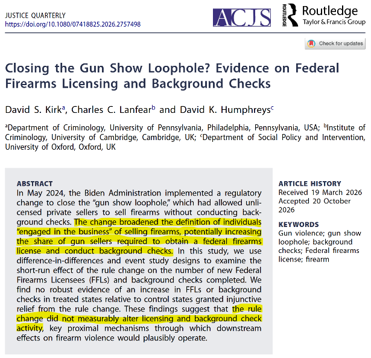
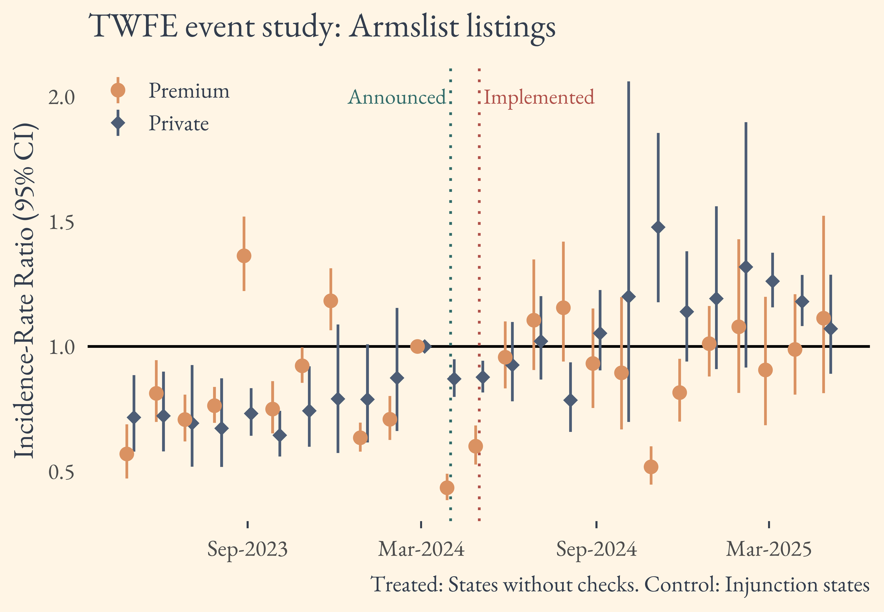

---
author:
  - name: Charles C. Lanfear
    affiliations: University of Cambridge
  - name: David S. Kirk
    affiliations: University of Pennsylvania
  - name: David Humphreys
    affiliations: University of Oxford
title: "The effect of closing the 'gun show loophole' on online gun sales listings"
format:
  revealjs:
    theme: assets/cclslides.scss
    incremental: false
    self-contained: false
    width: 1200
    height: 800
    auto-stretch: true
    title-slide-attributes:
      data-background-image: img/paisley.png
      data-background-position: bottom
      data-background-size: contain
filters: 
  - assets/invert-h1.lua
editor: source
mouse-wheel: true
history: false
---

```{r setup, include=FALSE}
knitr::opts_chunk$set(dev.args = list(bg = "transparent"))
library(tidyverse)
library(sf)
#remotes::install_github("wmurphyrd/fiftystater")
library(fiftystater)
library(fixest)
library(ggfixest)
library(showtext)
font_add_google("EB Garamond")
showtext_auto()


usa <- fifty_states |>
  mutate(state = str_to_title(id),
         injunction = id %in% c("texas", "louisiana", "mississippi", "utah"),
         existing = id %in% c("district of columbia", "oregon", "washington", 
                                         "california", "new mexico", "colorado", "nebraska", 
                                         "minnesota", "illinois", "michigan", "virginia", 
                                         "pennsylvania", "maryland", "new york", 
                                         "massachusetts", "vermont", "connecticut", 
                                         "delaware", "rhode island", "new jersey", "nevada", "hawaii"),
         eligible = ifelse(existing, "Pre-Existing", "Eligible"),
         treated = !injunction & !existing,
         status = factor(case_when(
           injunction ~ "Injunction",
           existing ~ "Pre-Existing",
           treated ~ "Affected",
           TRUE ~ "ERROR"
         ), levels = c("Affected", "Pre-Existing", "Injunction"))
         )


```


## {}



::: {.notes}

As part of the Bipartisan Safer Communities Act, the Biden administration moved to "close the gun show loophole" with a rule change broadening the definition of individuals
engaged in the business of selling firearms. This would potentially increase the proportion of 
sellers required to obtain Federal Firearms Licenses and conduct background checks. The policy was announced in April 2024 and took effect in May.

In a paper that came out last week, we found this policy had no effect in increasing either FFLS
or background checks. But, it is possible that despite this, it may have caused some 
private sellers to stop selling guns or shift to selling through FFL-holding businesses.
In this paper, we look to see whether this happened on online gun markets.

:::

## {}

```{r}
col_vec = c("Affected"= "#4d5d75", "Pre-Existing"= "#7eb7cc", "Injunction" = "#da9262")

ggplot(usa) +
  geom_polygon(aes(x = long, y = lat, group = group, fill = status), color = "#333d4d", linewidth = 0.25) +
  scale_fill_manual(values = col_vec, name = NULL, labels = c("Affected" = "Affected, no BG checks", "Pre-Existing" = "Affected, had BG checks", "Injunction"="Unaffected")) +
  coord_cartesian(ratio = 1.3) +
  theme_void(base_size = 20, base_family = "EB Garamond") +
  theme(legend.position = "bottom",
        # legend.position.inside = c(0.9, 0.15),
        legend.text = element_text(size = rel(2)),
        plot.background = element_rect(fill = "#fff5e5", color = "#fff5e5"),
        panel.background = element_rect(fill = "#fff5e5", color = "#fff5e5"),
        text = element_text(color = "#333d4d"),)
```


::: {.notes}


After the policy change was announced, four states sued the federal government and obtained an injunction blocking the policy from taking effect. This means there are three sets of states to compare: (a) those affected by the law but who had pre-existing requirements for background checks for gun sales, (b) those affected but without existing background check rules, and (c) those not affected due to the injunction. Today I will compare the unaffected injunction states to the affected ones without existing background check laws.

:::

## Craigslist for guns


::: {.notes}

To look at changes in gun markets, we scraped data from Armslist, essentially a Craigslist for guns. Sellers on Armslist are split into private sellers and premium sellers, where premium sellers must have an FFL. Our expectation is that if the policy had an impact on markets, it would cause a shift from private to premium sellers.

:::

## {}

```{r, echo=FALSE, warning=FALSE, message=FALSE}
load("./data/analysis_data.RData")
library(lubridate)
treat_date <- "2024-03-01"
breaks <- as.Date(treat_date) - months(c(-12, -6, 0, 6, 12))
event_study_plot <- fepois(
  private_listings ~ i(month_id, treated, ref = 11) | state_id + month_id,
  data =  analysis_data |> filter(policy_eligible == 1),
  cluster = ~state_id
) |>
  iplot_data() |>
  mutate(lhs = "Private") |>
  bind_rows(
     fepois(
       premium_listings ~ i(month_id, treated, ref = 11) | state_id + month_id,
       data =  analysis_data |> filter(policy_eligible == 1),
       cluster = ~state_id
     ) |>
    iplot_data() |>
    mutate(lhs = "Premium")) |>
  mutate(across(c(estimate, ci_low, ci_high, y), ~exp(.))) |>
  left_join(analysis_data |> distinct(month, x= month_id)) |>
  ggplot(aes(x = month, y = y, ymin = ci_low, ymax = ci_high, group = lhs, color = lhs, shape = lhs)) +
  scale_color_manual(values = c("Premium" = "#da9262", "Private" = "#4d5d75")) +
  scale_shape_manual(values = c("Premium" = 16, "Private" = 18)) +
  geom_hline(yintercept = 1, linetype = "solid") +
  geom_vline(xintercept = as.Date("2024-05-01"), color = "#b0514a", linetype = "dotted") +
  geom_vline(xintercept = as.Date("2024-04-01"), color = "#326b69", linetype = "dotted") +
  annotate("text", size = 4, label = "Announced ", x = as.Date("2024-04-01"), y = 2,  hjust = 1, color = "#326b69") +
  annotate("text", size = 4, label = " Implemented", x = as.Date("2024-05-01"), y = 2,  hjust = 0, color = "#b0514a") +
  scale_x_date(date_labels = "%b-%Y", breaks = breaks) +
  geom_pointrange(position = position_dodge(width = 15)) +
  labs(x = NULL, 
       y = "Incidence-Rate Ratio (95% CI)", 
       title = 'TWFE event study: Armslist listings',
       caption = "Treated: States without checks. Control: Injunction states") +
  theme_minimal(base_size = 15, base_family = "EB Garamond") +
  theme(legend.title = element_blank(),
        legend.position = "inside",
        legend.position.inside = c(0.1, 0.9),
        text = element_text(color = "#333d4d"),
        strip.text =  element_text(color = "#333d4d"),
        axis.text.x = element_text(size = rel(1)),
        axis.ticks.x = element_line(color = "#333d4d", linewidth = 0.5),
        # axis.text.y = element_blank(),
        # axis.ticks.y = element_blank(),
        panel.grid = element_blank(),
        panel.background = element_rect(fill = "#fff5e5", color = NA),
        plot.background = element_rect(fill = "#fff5e5", color = NA))

filename <- "img/event_study_plot.pdf"
ggsave(plot = event_study_plot, filename = filename, height = 4.5, width = 6.5)
plot_pdf <- pdftools::pdf_render_page(filename, dpi = 1200)
png::writePNG(plot_pdf, str_replace(filename, "\\.pdf", ".png" ), dpi = 1200)

```



::: {.notes}

We examined this with a two-way fixed effects event study design. Estimates are month-specific effects of the policy change relative to March 2025 before the policy was announced. What we see here is an apparent massive decrease in premium, rather than private, listing in treated states in just the month of announcement and implementation.

:::

## {}

```{r}
state_plot <- analysis_data |>
  mutate(state_type = case_when(
    injunction == "yes" ~ "Injunction",
    treated==1 ~ "Affected",
    treated==0 & injunction == "no" ~ "Pre-Existing"
  )) |>
  mutate(state_type = factor(state_type, levels = c("Affected", "Pre-Existing", "Injunction"))) |>
  pivot_longer(c(listings, premium_listings, private_listings), names_to = "listing_type", values_to = "count") |>
  filter(!is.na(count)) |>
  summarize(count = mean(count), .by = c(state_type, month, listing_type)) |>
  filter(listing_type != "listings") |>
  mutate(listing_type = factor(listing_type, levels = c("premium_listings", "private_listings"), labels = c("Premium", "Private"))) |>
  ggplot(aes(x = month, y = count, group = state_type, color = state_type)) +
  geom_vline(xintercept = as.Date("2024-05-01"), color = "#b0514a", linetype = "dotted") +
  geom_vline(xintercept = as.Date("2024-04-01"), color = "#326b69", linetype = "dotted") +
  geom_line() +
  facet_wrap(~listing_type) +
  scale_y_log10() +
  scale_x_date(date_labels = "%b-%Y", breaks = breaks) +
  scale_color_manual(values = col_vec, name = NULL, labels = c("Affected" = "Affected, no BG checks", "Pre-Existing" = "Affected, had BG checks", "Injunction"="Unaffected")) +
  labs(x=NULL, y= "Listings", color = NULL, title = 'Mean Armslist listings by treatment group') +
  theme_minimal(base_size = 15, base_family = "EB Garamond") +
  theme(legend.title = element_blank(),
        legend.position = "inside",
        legend.position.inside = c(0.05, 0.9),
        text = element_text(color = "#333d4d"),
        strip.text =  element_text(color = "#333d4d"),
        axis.text.x = element_text(size = rel(1)),
        axis.ticks.x = element_line(color = "#333d4d", linewidth = 0.5),
        # axis.text.y = element_blank(),
        axis.ticks.y = element_line(color = "#333d4d", linewidth = 0.5),
        panel.grid = element_blank(),
        panel.background = element_rect(fill = "#fff5e5", color = NA),
        plot.background = element_rect(fill = "#fff5e5", color = NA))

filename <- "img/state_plot.pdf"
ggsave(plot = state_plot, filename = filename, height = 5, width = 7)
plot_pdf <- pdftools::pdf_render_page(filename, dpi = 1200)
png::writePNG(plot_pdf, str_replace(filename, "\\.pdf", ".png" ), dpi = 1200)

```


::: {.notes}

It turns out what this is actually due not to a decrease in premium listings in treated states, but rather a massive spike in listings in the untreated injunction states. That is, it seems the policy triggered a flurry of new sales mainly in Texas---in line with surges in gun sales commonly seen when there are fears gun control legislation will be passed. But it quickly levels out afterward.

:::

## tl;dr {.dark-slide}

&nbsp;

"Closing the gun show loophole" had **no significant impact on online private sales** but likely produced a brief but massive increase followed by a rebound in listings from dealers in **unaffected states** (mainly Texas)


## Thank you {background-image="img/paisley.png" background-position="bottom" background-size="contain"}

&nbsp;


Contact:

| Charles C. Lanfear
| Institute of Criminology
| University of Cambridge
| [clanfear.github.io](https://clanfear.github.io)
| [cl948\@cam.ac.uk](mailto:cl948@cam.ac.uk)


